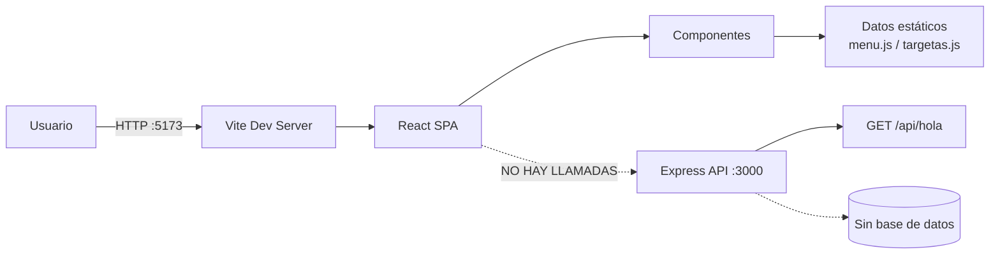
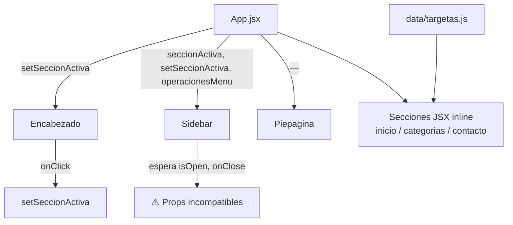
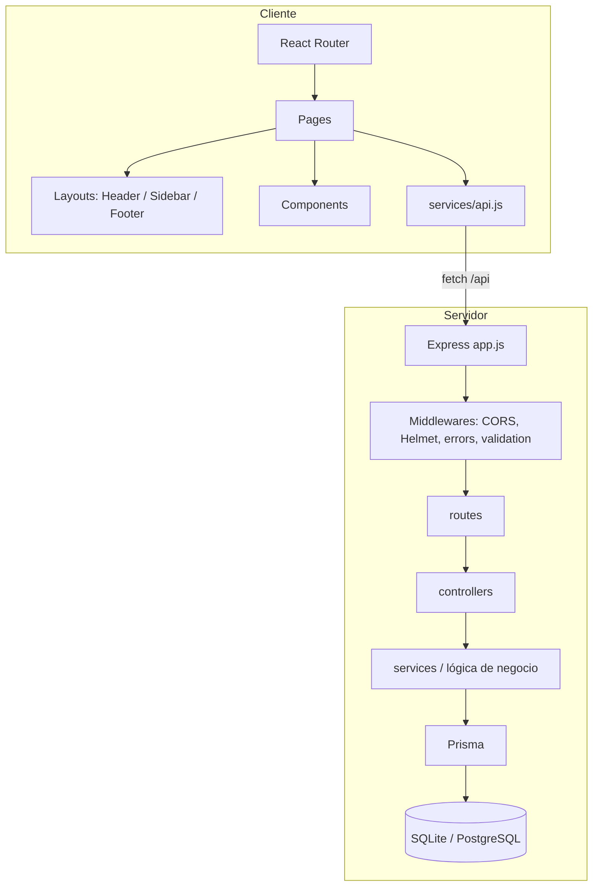

# Informe de Arquitectura — Hilo y Estilo

**Fecha:** 22 de noviembre de 2026
**Repositorio:** `/home/pc/Documentos/Hilo_y_estilo`
**Rama analizada:** `feature/Rodrigo/desarrollador4` (HEAD `8326bef`, mergeada en `develop` como `f0e0bbf`)
**Alcance:** revisión estática del código, estructura de carpetas, dependencias, historial Git y verificación de compilación.

---

## 1. Resumen ejecutivo

**Hilo y Estilo** es el sitio web de una iniciativa de distribución y venta de insumos textiles artesanales de Popayán (Cauca). Técnicamente es un **prototipo de frontend SPA** construido con **React 19 + Vite**, acompañado de un **esqueleto de backend con Express** que todavía no presta servicios reales.

Estado general:

| Aspecto | Valoración | Comentario |
|---|---|---|
| Estructura del repositorio | 🟡 Aceptable | Separación `frontend/` y `backend/`, pero con archivos huérfanos en la raíz |
| Frontend (React) | 🟡 Funcional con fallos | Compila, pero hay navegación incompleta y componentes desconectados |
| Backend (Express) | 🔴 Mínimo | Una sola ruta de prueba (`/api/hola`), sin integración con el frontend |
| Estilos / diseño | 🟠 Inconsistente | Tres sistemas visuales distintos conviviendo; dos hojas de estilo no se usan |
| Calidad / pruebas | 🔴 Ausente | Sin tests, sin linter, sin CI, sin tipado |
| Documentación | 🔴 Ausente | `README.md` de una sola línea |
| Seguridad | 🟠 Básica | Sin CORS, sin Helmet, sin validación, sin variables de entorno gestionadas |
| Proceso de Git | 🟠 Mejorable | Ramas por desarrollador, merges cruzados, un `revert`, nombres inconsistentes |

**Conclusión corta:** el proyecto es un **maqueta visual (mockup) navegable**, no una aplicación completa. La arquitectura base (React + Vite / Express) es correcta y está bien elegida para el objetivo, pero falta la capa de integración, la organización interna y el aseguramiento de calidad para considerarlo un producto.

---

## 2. Stack tecnológico

### Frontend

| Dependencia | Declarado | Instalado | Uso real |
|---|---|---|---|
| `react` | `^19.2.8` | `19.3.1` | ✅ Base de la UI |
| `react-dom` | `^19.2.8` | `19.3.1` | ✅ Renderizado |
| `react-router` | `^8.5.1` | `8.5.1` | ❌ **Instalado pero nunca importado** |
| `vite` | `^8.3.0` | `8.3.5` | ✅ Build y dev server |
| `@vitejs/plugin-react` | `^6.1.1` | `6.2.1` | ✅ Transformación JSX |

### Backend

| Dependencia | Declarado | Uso real |
|---|---|---|
| `express` | `^4.21.2` | ✅ Servidor HTTP, una sola ruta |
| — | — | ❌ Sin `cors`, `dotenv`, `helmet`, `nodemon` (usa `node --watch`), ORM ni base de datos |

> **Nota:** `backend/node_modules` no existe en el entorno; el backend **no está instalado** y no se puede ejecutar sin `npm install`.

---

## 3. Estructura del repositorio

```
Hilo_y_estilo/
├── .gitignore
├── README.md                     # 1 línea: "# Hilo y Estilo"
├── Hero.css                      # ⚠️ 278 KB — NO es CSS (volcado PostScript de ImageMagick)
│
├── backend/
│   ├── .gitignore
│   ├── package.json              # Express, type: module
│   ├── package-lock.json
│   └── src/
│       ├── index.js              # Servidor Express (14 líneas)
│       └── App.jsx               # ⚠️ archivo vacío, sin seguimiento en Git
│
└── frontend/
    ├── .gitignore
    ├── index.html                # ⚠️ etiquetas </html> duplicadas
    ├── package.json
    ├── package-lock.json
    ├── vite.config.js            # Solo plugin React, sin proxy ni alias
    └── src/
        ├── main.jsx              # Bootstrap de React
        ├── App.jsx               # Componente raíz (137 líneas)
        ├── App.css               # Estilos globales + todas las secciones (387 líneas)
        ├── components/
        │   ├── Encabezado.jsx    # ✅ En uso
        │   ├── Piepagina.jsx     # ✅ En uso
        │   ├── Sidebar.jsx       # ⚠️ En uso, pero con props incorrectas
        │   ├── Sidebar.css       # ✅ Incluido en el bundle
        │   ├── Navbar.jsx        # ❌ Código muerto (no se importa)
        │   ├── Navbar.css        # ❌ No entra al bundle
        │   ├── Hero.jsx          # ❌ Código muerto (no se importa)
        │   └── Hero.css          # ❌ No entra al bundle
        └── data/
            ├── menu.js           # Menú lateral (se pasa como prop, pero no se usa)
            └── targetas.js       # Catálogo de categorías (sí se usa)
```

**Verificación del bundle:** el build de producción genera **228.72 kB de JS** (71.27 kB gzip) y **6.31 kB de CSS**. El CSS final contiene `.sidebar-drawer`, `.pildora` y `.card-categoria`, pero **no** contiene `.hero-section` ni `.navbar-container`, lo que confirma que `Hero.css` y `Navbar.css` son código muerto.

---

## 4. Arquitectura actual

### 4.1 Vista de alto nivel



**Hallazgo clave:** frontend y backend están **completamente desacoplados**. El backend existe, pero el frontend nunca lo consume. No hay `fetch`, `axios`, ni proxy en `vite.config.js`.

### 4.2 Navegación: enrutamiento por estado (no por URL)

El "router" real del proyecto es un único `useState`:

```jsx
// frontend/src/App.jsx:10
const [seccionActiva, setSeccionActiva] = useState('inicio')
```

El encabezado cambia ese estado y `App.jsx` renderiza condicionalmente tres secciones:

| Sección declarada en el menú | Renderiza contenido |
|---|---|
| `inicio` | ✅ |
| `categorias` | ✅ |
| `contacto` | ✅ |
| `sesion` | ❌ **Pantalla en blanco** |
| `añadir` | ❌ **Pantalla en blanco** |
| `ventas` | ❌ **Pantalla en blanco** |
| `envios` | ❌ **Pantalla en blanco** |
| `cuenta` | ❌ **Pantalla en blanco** |

El menú (`Encabezado.jsx:38-44`) ofrece 8 botones, pero `App.jsx:27,98,115` solo tiene bloques para 3. Al pulsar "Ventas", "Envíos", "Cuenta", etc., el área principal queda vacía. Además, **no hay URL por sección**: no se puede enlazar, recargar ni compartir una vista, y el botón "atrás" del navegador no funciona.

### 4.3 Componentes y flujo de props



**Desajuste de contrato en `Sidebar`:**

- `App.jsx:18-22` le pasa: `seccionActiva`, `setSeccionActiva`, `operacionesMenu`.
- `Sidebar.jsx:4` espera: `isOpen`, `onClose`.

Resultado: `isOpen` es siempre `undefined`, por lo que el panel lateral **nunca se abre** (`sidebar-drawer` queda en `left: -320px`), y no existe ningún botón que lo active (el disparador está en `Navbar.jsx`, que no se usa). El componente se renderiza pero es **invisible e inerte**. Además `operacionesMenu` se importa y se pasa, pero no se consume en ninguna parte.

---

## 5. Análisis por capa

### 5.1 Backend (`backend/src/index.js`)

```js
import express from 'express';
const app = express();
app.use(express.json());

app.get('/api/hola', (_req, res) => {
  res.json({ mensaje: 'Hola desde el backend de Hilo y Estilo 👋' });
});

const PORT = process.env.PORT || 3000;
app.listen(PORT, () => { /* log */ });
```

**Lo que está bien:**
- Uso de ES Modules (`"type": "module"`).
- Puerto configurable por variable de entorno.
- Script `dev` con `node --watch` (sin dependencia extra).

**Lo que falta:**
- Estructura por capas (`routes/`, `controllers/`, `services/`, `models/`, `middlewares/`).
- CORS: aunque el frontend corra en `:5173`, no hay cabeceras CORS; cualquier llamada desde el navegador fallaría.
- Middleware de errores y ruta 404.
- Validación de entrada (no hay endpoints que la necesiten aún, pero tampoco infraestructura).
- Persistencia: **no hay base de datos** (ni SQLite, ni PostgreSQL, ni MongoDB).
- Autenticación/autorización (el menú ya promete "Inicio de sesión" y "Cuenta").
- Manejo de variables de entorno con `.env` + `.env.example`.
- Cierre ordenado del servidor (`SIGTERM`) y separación `app` / `server` para testabilidad.

### 5.2 Frontend

**Puntos correctos:**
- Bootstrap limpio con `StrictMode` (`main.jsx`).
- Componentes funcionales y funciones flecha consistentes.
- Datos separados de la vista en `src/data/`.
- `key={item.id || index}` en el listado de categorías.
- El build de producción funciona sin errores ni advertencias.

**Problemas:**
1. **`App.jsx` es un "god component"**: contiene el header, el layout, el hero, tres secciones completas y el formulario. Debería dividirse en páginas (`Home`, `Catalogo`, `Contacto`) y componentes de sección.
2. **Código muerto**: `Hero.jsx`, `Navbar.jsx` (y sus CSS) no se importan en ninguna parte. Representan un diseño alternativo que quedó a medio integrar.
3. **`react-router` instalado sin usar**: la dependencia correcta para resolver la navegación ya está en `package.json`.
4. **Formulario de contacto simulado**: `onSubmit` lanza `alert('¡Mensaje enviado con éxito!')` (`App.jsx:119`). No envía nada ni valida más allá de `required`.
5. **Iconos sin librería**: `Encabezado.jsx:29` usa `<i className="fa-solid fa-bag-shopping">`, pero **Font Awesome no está cargado** en `index.html` → el icono del carrito no se ve.
6. **Tipografías no cargadas**: se referencian `'Cinzel'`, `'Plus Jakarta Sans'` (y en `style.css` de `develop`, `'Playfair Display'` y `'Poppins'`), pero no hay `<link>` a Google Fonts ni `@font-face`. Todo cae a `serif`/`sans-serif` genéricas.
7. **`index.html` mal formado**: hay dos `</html>` de cierre (`index.html:12-17`).
8. **Sin manejo de estado global ni de datos remotos**: no hay `loading`, `error`, ni fetching.
9. **Sin accesibilidad**: inputs sin `<label>`, botones con emoji como única etiqueta, sin `aria-*`, sin foco gestionado en el drawer.

### 5.3 Estilos

Conviven **tres lenguajes visuales distintos**:

| Fuente | Paleta | Tipografía | Estado |
|---|---|---|---|
| `App.css` | Azul noche `#070a14` + azul `#1e3a8a` + dorado `#D4AF37` | `Plus Jakarta Sans` / `serif` | ✅ En uso |
| `components/Hero.css` + `Navbar.css` | Negro azulado + dorado | `Cinzel` | ❌ No se usan |
| `style.css` (rama `develop`, eliminado en HEAD) | Marrón `#5d4037` + arena `#d4a373` | `Playfair Display` / `Poppins` | ❌ Huérfano |

Además:
- `App.css` define estilos **globales** (`body`, tipografía) mezclados con estilos de sección; no hay `index.css` ni variables CSS (`:root`) en la rama actual.
- No hay design tokens ni convención (BEM, CSS Modules, Tailwind). Todo es CSS global con nombres en español e inglés mezclados (`header-principal`, `hero-grid`, `card-colab`).
- **`Hero.css` en la raíz no es CSS**: es un volcado PostScript de ImageMagick (`%!PS-Adobe-3.0`), de 278 KB y 3.732 líneas. Es un archivo basura sin seguimiento en Git. Debe eliminarse.
- Existe un `dist/` generado localmente (ignorado por `.gitignore`).

### 5.4 Datos

- `src/data/targetas.js`: 3 categorías de insumos, correctamente consumidas en `App.jsx:102`.
- `src/data/menu.js`: 5 ítems con iconos Font Awesome; se importa y se pasa a `Sidebar`, pero **nunca se renderiza**. Sus iconos tampoco funcionarían (Font Awesome ausente).

---

## 6. Hallazgos priorizados

| # | Severidad | Hallazgo | Evidencia | Impacto |
|---|---|---|---|---|
| 1 | 🔴 Alta | 5 de 8 secciones del menú no renderizan nada | `Encabezado.jsx:38-44` vs `App.jsx:27,98,115` | El usuario ve una pantalla vacía |
| 2 | 🔴 Alta | El `Sidebar` recibe props incompatibles y nunca se abre | `App.jsx:18-22` / `Sidebar.jsx:4` | Funcionalidad lateral inutilizable |
| 3 | 🔴 Alta | No existe integración frontend ↔ backend | Sin `fetch`/`axios`; `vite.config.js` sin proxy | El "sistema" no tiene datos reales |
| 4 | 🟠 Media | `Hero.jsx` y `Navbar.jsx` son código muerto | No hay imports; CSS ausente del bundle | Confusión y mantenimiento doble |
| 5 | 🟠 Media | `Hero.css` raíz es un binario PostScript de 278 KB | `head Hero.css` → `%!PS-Adobe-3.0` | Ruido en el repo, riesgo de confusión |
| 6 | 🟠 Media | Navegación por estado, sin URLs | `useState('inicio')` | Sin deep-linking, sin historial, sin SEO |
| 7 | 🟠 Media | Formulario de contacto falso (`alert`) | `App.jsx:119` | Expectativa incumplida al usuario |
| 8 | 🟠 Media | Tipografías e iconos no cargados | `index.html` sin `<link>`; `fa-solid` sin CDN | Identidad visual rota |
| 9 | 🟡 Baja | `backend/src/App.jsx` vacío y sin seguimiento | Archivo de 1 byte | Estructura confusa (React en backend) |
| 10 | 🟡 Baja | `index.html` con etiquetas duplicadas | `index.html:12-17` | HTML inválido |
| 11 | 🟡 Baja | `react-router` instalado sin uso | `package.json:14` | Peso innecesario (deuda) |
| 12 | 🟡 Baja | Backend sin CORS, 404 ni manejo de errores | `backend/src/index.js` | Bloquea cualquier integración futura |
| 13 | 🟡 Baja | Sin tests, linter, CI ni tipado | No hay `*.test.*`, `.eslintrc`, `.github/workflows` | Regresiones silenciosas |
| 14 | 🟡 Baja | `README.md` de una línea | `README.md` | Sin guía de instalación/ejecución |

---

## 7. Proceso de desarrollo y Git

- **13 ramas remotas** para un proyecto de este tamaño, la mayoría por desarrollador (`feature/Rodrigo/desarrollador4`, `feature/Eduardo/desarrollador3`, etc.), lo que genera merges cruzados frecuentes (`85ccc41`, `c945579`, `c53d185`).
- **10 autores** distintos en el historial, varios con doble identidad (`Rodrigo Mejia` / `rodrimejia-ux`, `Juan David` / `sjuandavid223-rgb`).
- Un **`revert`** de un merge (`e3cefce`) y commits WIP de stash (`527f192`, `ca9214b`), señal de conflictos mal resueltos.
- Nombres de rama inconsistentes: `feacture/BrianTorres/Texto` (typo de *feature*).
- Archivos fuera de la estructura estándar en otras ramas: `App.jsx` y `Encabezado.css` en la raíz, `piedepagina/PiePagina.jsx`, `imagenes/`, `Texto.html`, `Productos y colaboladores.html`. Cada integrante trabajó en su propio esqueleto y luego se consolidó a mano.
- No hay protección de rama, ni PR templates, ni convención de commits (aunque varios usan *Conventional Commits* de forma correcta).

---

## 8. Recomendaciones

### 8.1 Corto plazo (limpieza, 1–2 días)

1. Eliminar `Hero.css` de la raíz y `backend/src/App.jsx`.
2. Decidir el destino de `Hero.jsx`/`Navbar.jsx`: **integrarlos** (son visualmente superiores) o **borrarlos** junto con sus CSS.
3. Corregir el contrato de `Sidebar` (`isOpen`/`onClose`) y añadir un botón de apertura en `Encabezado` o integrar `Navbar`.
4. Cargar tipografías (Google Fonts) y Font Awesome, o sustituir los iconos por SVG/emoji.
5. Corregir `index.html` y escribir un `README.md` real (requisitos, instalación, scripts, estructura).
6. Ocultar o implementar las secciones vacías del menú.

### 8.2 Medio plazo (arquitectura, 1–2 semanas)

1. **Adoptar `react-router`** con rutas reales:
   ```
   /                → Home
   /catalogo        → Categorías
   /contacto        → Contacto
   /login, /cuenta, /ventas, /envios, /admin/productos
   ```
   Con `createBrowserRouter` y un layout compartido (`Header`, `Outlet`, `Footer`).
2. **Dividir `App.jsx`** en `layouts/`, `pages/` y `components/`.
3. **Estructurar el backend**:
   ```
   backend/src/
   ├── app.js            # configuración Express
   ├── server.js         # arranque
   ├── routes/
   ├── controllers/
   ├── services/
   ├── middlewares/      # cors, errores, 404, validación
   └── config/
   ```
   Añadir `cors`, `dotenv`, `helmet`, `express-rate-limit`.
4. **Integrar**: `VITE_API_URL` en el frontend + proxy `/api` en Vite; capa `src/services/api.js`.
5. **Modelo de datos** mínimo: productos/categorías, usuarios, pedidos. Elegir SQLite + Prisma para empezar rápido, o PostgreSQL si el despliegue lo requiere.
6. **Sistema de diseño único**: `src/styles/tokens.css` con variables (`--color-primary`, `--font-display`), y CSS Modules o Tailwind para evitar colisiones globales.

### 8.3 Largo plazo (calidad y producto)

1. ESLint + Prettier + `lint-staged` + Husky.
2. Vitest + React Testing Library (frontend) y Supertest (backend).
3. GitHub Actions: `lint`, `test`, `build` en cada PR; plantilla de PR y protección de `main`.
4. TypeScript (o al menos JSDoc) para contratos de props y respuestas de API.
5. Autenticación real (JWT o sesiones) para las secciones "Cuenta", "Ventas" y "Añadir producto".
6. Accesibilidad: `label` en formularios, `aria-*` en el drawer, navegación por teclado, contraste.
7. SEO/marketing: metadatos, Open Graph, `sitemap.xml`; o migrar a SSR (Next.js/Remix) si el catálogo debe indexarse.

---

## 9. Arquitectura objetivo sugerida



---

## 10. Cómo verificar este informe

```bash
# 1. El frontend compila
cd frontend && npm run build

# 2. El CSS del bundle confirma el código muerto
grep -o "hero-section\|navbar-container\|sidebar-drawer" dist/assets/*.css | sort | uniq -c

# 3. Hero.css de la raíz no es CSS
head -3 Hero.css        # → %!PS-Adobe-3.0

# 4. El backend no está instalado ni integrado
ls backend/node_modules 2>/dev/null || echo "no instalado"
grep -rn "fetch\|axios" frontend/src || echo "sin llamadas a la API"

# 5. Secciones del menú sin render
grep -n "seccionActiva ===" frontend/src/App.jsx
grep -n "setSeccionActiva('" frontend/src/components/Encabezado.jsx
```

---

## 11. Conclusión

Hilo y Estilo tiene una **base técnica acertada** (React 19 + Vite, Express con ES Modules), una **identidad visual atractiva** y un **contenido bien redactado** orientado al sector textil caucano. El build es limpio y rápido.

Sin embargo, hoy es un **prototipo visual**, no una aplicación: la navegación está incompleta, hay componentes y hojas de estilo desconectados, el backend no se usa, y no existen pruebas ni documentación. La buena noticia es que la mayoría de los problemas son de **organización e integración**, no de rediseño: con las tareas de corto y medio plazo (router, limpieza de código muerto, estructura del backend y sistema de diseño unificado) el proyecto puede pasar de maqueta a MVP funcional en pocas semanas.

**Prioridad inmediata:** resolver los hallazgos 1, 2 y 3 — navegación completa, `Sidebar` funcional e integración real con la API.

---

## Nota de estado actual

Este informe es la **auditoría inicial**. Las cuatro fases posteriores ya se ejecutaron:
el backend es Django + DRF + MySQL, el frontend usa router y módulos por dominio,
la API tiene envelope único, hay 32 pruebas sobre MySQL real y la semilla limpia
vive en `backend/fixtures/catalogo_inicial.json`.

Para instalación reproducible en equipos del SENA consulta **`docs/SETUP_SENA.md`**;
para el detalle de lo implementado, **`docs/FASE-1-PLAN.md`** y **`docs/GUIA_DESARROLLO.md`**.
