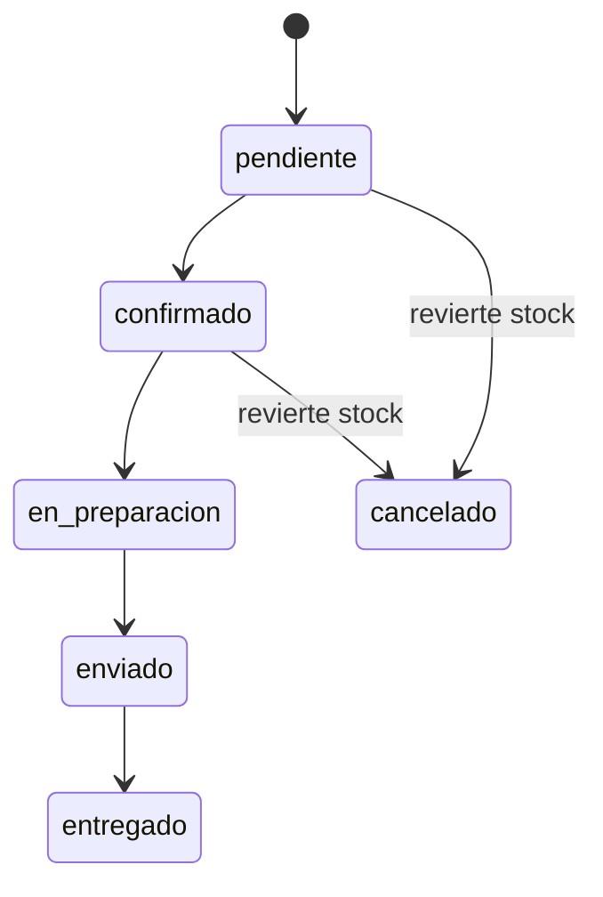

# Fase 1 — Plan de refactorización (React 19 + Django DRF + MySQL)

**Proyecto:** Hilo y Estilo
**Fecha:** 22 de noviembre de 2026
**Rama actual:** `feature/Rodrigo/desarrollador4`
**Estado:** ⏸️ Plan presentado — **no se ha borrado ni sobrescrito código del proyecto**. Este documento reemplaza el plan Node/Express + SQLite que quedó descartado.

---

## 1. Auditoría confirmada del repositorio

| Ítem | Evidencia | Estado |
|---|---|---|
| Frontend compila | `npm run build` → 228.72 kB JS / 6.31 kB CSS | ✅ |
| React 19 + Vite 8 + `react-router` 8.5 | `frontend/package.json` | ✅ Instalado, router sin usar |
| Navegación por `useState` | 8 botones en `Encabezado.jsx:38-44`; solo 3 vistas en `App.jsx:27,98,115` | 🔴 5 rutas vacías |
| `Sidebar` con contrato roto | Recibe `seccionActiva/setSeccionActiva/operacionesMenu`; espera `isOpen/onClose` (`Sidebar.jsx:4`) | 🔴 Inerte |
| Código muerto | `Hero.jsx`, `Navbar.jsx` y sus CSS no se importan (ausentes del bundle) | 🟠 Decidido: **integrar** |
| `Hero.css` raíz | `%!PS-Adobe-3.0`, 278 KB, sin tracking | 🟠 Decidido: **eliminar** |
| `backend/src/App.jsx` | Vacío, sin tracking | 🟠 Decidido: **eliminar** |
| `index.html` | Dos `</html>` (`index.html:12-17`) | 🟠 Corregir |
| Fuentes / iconos | `Cinzel`, `Plus Jakarta Sans`, `fa-solid` sin cargar | 🟠 Corregir |
| Backend actual | Express de 14 líneas, una ruta `/api/hola`, sin BD | 🔴 Reemplazar por Django |
| Python / venv | Python 3.12.3, `venv` y `ensurepip` disponibles | ✅ |
| Dependencias Python | Django/DRF/MySQL **no instalados** | ⚠️ Instalar en Fase 2 |
| MySQL | Servidor 8.0.46 activo en `127.0.0.1:3306`; cliente `mysql` disponible | ⚠️ Sin credenciales |
| Artefacto local | `.~lock.INFORME_ARQUITECTURA.md#` (LibreOffice) | Añadir a `.gitignore` |

---

## 2. Lo que necesito de ti: MySQL local

El servidor MySQL **ya está corriendo**, pero el usuario del sistema (`pc`) **no tiene acceso** y no hay `sudo` sin contraseña. No necesito que me compartas contraseñas: **necesito que ejecutes este SQL** (con tu usuario root de MySQL) y me confirmes los valores resultantes.

```sql
-- Conéctate con:  mysql -u root -p     (o: sudo mysql)
CREATE DATABASE IF NOT EXISTS hilo_y_estilo
  CHARACTER SET utf8mb4
  COLLATE utf8mb4_unicode_ci;

CREATE USER IF NOT EXISTS 'hilo_user'@'localhost' IDENTIFIED BY 'CAMBIA_ESTA_CLAVE';
CREATE USER IF NOT EXISTS 'hilo_user'@'127.0.0.1' IDENTIFIED BY 'CAMBIA_ESTA_CLAVE';

GRANT ALL PRIVILEGES ON hilo_y_estilo.* TO 'hilo_user'@'localhost';
GRANT ALL PRIVILEGES ON hilo_y_estilo.* TO 'hilo_user'@'127.0.0.1';
FLUSH PRIVILEGES;

SHOW DATABASES LIKE 'hilo_y_estilo';
SELECT user, host FROM mysql.user WHERE user = 'hilo_user';
```

### Variables que debe contener `backend/.env` (creado en Fase 2 a partir de `.env.example`)

```dotenv
DJANGO_SETTINGS_MODULE=config.settings.local
SECRET_KEY=cambiar-por-clave-larga-aleatoria
DEBUG=True
ALLOWED_HOSTS=localhost,127.0.0.1

DB_NAME=hilo_y_estilo
DB_USER=hilo_user
DB_PASSWORD=LA_CLAVE_QUE_ELIJAS
DB_HOST=127.0.0.1
DB_PORT=3306

CORS_ALLOWED_ORIGINS=http://localhost:5173,http://127.0.0.1:5173
JWT_ACCESS_MINUTES=15
JWT_REFRESH_DAYS=7
```

> **Notas técnicas**
> - Usamos `DB_HOST=127.0.0.1` (TCP) en lugar de `localhost` para evitar el socket Unix con PyMySQL.
> - Usaremos **PyMySQL** (puro Python) en vez de `mysqlclient`: no depende de headers del sistema. En `config/settings/base.py` se añade `pymysql.install_as_MySQLdb()` antes de la configuración de bases de datos.
> - Si prefieres otro nombre de BD/usuario, dime los valores y ajusto el `.env.example`.
> - Con `DEBUG=True` y SQLite no se requiere nada de esto, pero el stack pedido es **MySQL**, así que la BD es obligatoria para la Fase 2.

---

## 3. Decisiones ya tomadas (según tus respuestas)

| Decisión | Resultado |
|---|---|
| Backend | Django + DRF + MySQL (se descarta Express/SQLite) |
| `Hero.jsx` / `Navbar.jsx` | **Integrar** en `modules/home` y `layouts`/`Encabezado`; borrar duplicados |
| Diseño | Un único `styles/tokens.css`: azul noche `#070a14` / `#1e3a8a`, dorado `#D4AF37`. Sin marrones ni CSS duplicado |
| Sidebar | Contrato real `isOpen`/`onClose` + disparador funcional en el encabezado |
| Sesión | **JWT en cookie httpOnly** (con SimpleJWT adaptado), `credentials: 'include'` en el frontend |
| Borrados en Fase 2 | Autorizados (lista exacta en §8) |

### 3.1 Sesión JWT en cookie (detalle importante)

`djangorestframework-simplejwt` normalmente devuelve el token en el cuerpo JSON. Lo adaptamos sin perder la librería:

1. `POST /api/v1/auth/login/` (subclase de `TokenObtainPairView`) **devuelve 200 sin tokens en el body** y hace `set_cookie` de:
   - `access_token` → httpOnly, `SameSite=Lax`, `Secure` solo en producción, `Max-Age=900`.
   - `refresh_token` → httpOnly, `SameSite=Lax`, `Path=/api/v1/auth/refresh/`, `Max-Age=604800`.
2. `apps/core/authentication.py`: `CookieJWTAuthentication(JWTAuthentication)` lee `request.COOKIES['access_token']`. Es el único `DEFAULT_AUTHENTICATION_CLASSES`.
3. `POST /api/v1/auth/refresh/`: rota el refresh y vuelve a fijar ambas cookies (blacklist activada).
4. `POST /api/v1/auth/logout/`: elimina cookies y añade el refresh a blacklist.
5. Protección CSRF complementaria: middleware `OriginCheckMiddleware` que exige `Origin` permitido en métodos `POST/PATCH/PUT/DELETE` + `SameSite=Lax` + `CORS_ALLOW_CREDENTIALS=True`.
6. `apiClient.js` intercepta `401`, llama una vez a `/auth/refresh/`, reintenta la petición y, si falla, limpia el `AuthContext` y redirige a `/login`.

---

## 4. Plan de carpetas — BACKEND Django

```
backend/
├── .env.example                     # variables de la sección 2
├── .gitignore                       # .env, venv/, __pycache__/, media/, staticfiles/
├── requirements.txt                 # django, djangorestframework, django-cors-headers,
│                                    # djangorestframework-simplejwt, PyMySQL, python-dotenv,
│                                    # drf-spectacular, pytest? (Fase 4)
├── manage.py                        # DJANGO_SETTINGS_MODULE=config.settings.local
│
├── config/
│   ├── __init__.py
│   ├── urls.py                      # /api/v1/, /api/schema/, /api/docs/, /django-admin/
│   ├── asgi.py
│   ├── wsgi.py
│   └── settings/
│       ├── __init__.py
│       ├── base.py                  # INSTALLED_APPS, DRF, SIMPLE_JWT, MySQL, CORS, spectacular
│       ├── local.py                 # DEBUG, SQLite opcional para tests, console email
│       └── prod.py                  # secure cookies, HTTPS, ALLOWED_HOSTS, static
│
└── apps/
    ├── core/
    │   ├── __init__.py
    │   ├── apps.py
    │   ├── authentication.py        # CookieJWTAuthentication
    │   ├── permissions.py           # IsAdminUserRole, IsOwnerOrAdmin
    │   ├── pagination.py            # StandardResultsSetPagination (page_size=12)
    │   ├── exceptions.py            # custom_exception_handler → envelope {error:{...}}
    │   ├── middleware.py            # OriginCheckMiddleware
    │   ├── models.py                # TimeStampedModel abstracto
    │   └── views.py                 # APIView base / healthcheck
    │
    ├── usuarios/
    │   ├── models.py                # Usuario(AbstractUser) + rol
    │   ├── serializers.py           # Registro, Login, Perfil
    │   ├── views.py                 # register/login/logout/me/refresh
    │   ├── urls.py
    │   ├── admin.py
    │   └── migrations/
    │
    ├── catalogo/
    │   ├── models.py                # Categoria, Producto
    │   ├── serializers.py
    │   ├── viewsets.py              # ViewSet público + ViewSet admin
    │   ├── filters.py               # búsqueda por q, categoria, activo, stock_bajo
    │   ├── urls.py                  # router DRF
    │   ├── admin.py
    │   └── migrations/
    │
    ├── pedidos/
    │   ├── models.py                # Pedido, ItemPedido
    │   ├── serializers.py
    │   ├── services.py              # crear_pedido() con @transaction.atomic + select_for_update
    │   ├── views.py
    │   ├── urls.py
    │   ├── admin.py
    │   └── migrations/
    │
    ├── envios/
    │   ├── models.py                # Envio (OneToOne con Pedido)
    │   ├── serializers.py
    │   ├── views.py
    │   ├── urls.py
    │   ├── admin.py
    │   └── migrations/
    │
    ├── contacto/
    │   ├── models.py                # MensajeContacto
    │   ├── serializers.py
    │   ├── views.py
    │   ├── urls.py
    │   └── admin.py
    │
    └── admin_panel/                 # agregación de endpoints /api/v1/admin/...
        ├── views.py                 # dashboard, ventas, despachos
        ├── serializers.py
        └── urls.py
```

**Convenciones**
- Todo bajo `/api/v1/` desde el primer commit (versionado).
- El admin nativo de Django en **`/django-admin/`** para no chocar con la SPA React en `/admin`.
- Cada app con `apps.py`, `admin.py`, `migrations/`, `tests/` (Fase 4).
- `config/settings/` se elige con `DJANGO_SETTINGS_MODULE`; `manage.py` usa `local` por defecto.
- Los modelos abstractos y utilidades compartidas viven en `apps/core` (ninguna app importa `views` de otra).

---

## 5. Modelos relacionales (MySQL, migraciones iniciales)

Convenciones: `BigAutoField` como PK; dinero `DecimalField(max_digits=12, decimal_places=2)`; `created_at`/`updated_at` de `TimeStampedModel`; integridad referencial con `PROTECT` donde el histórico importa y `CASCADE` donde el hijo no tiene vida propia; nombres de tablas en singular (`db_table = 'producto'`).

### 5.1 `usuarios.Usuario` — `AbstractUser`

| Campo | Tipo | Detalle |
|---|---|---|
| `rol` | CharField(20), choices `cliente`/`admin` | default `cliente`, DB check |
| `telefono` | CharField(30), blank | contacto |
| `direccion` | CharField(255), blank | taller / entrega |
| `ciudad` | CharField(100) | default `Popayán` |
| `barrio` | CharField(100), blank | localidad |
| `nombre_taller` | CharField(150), blank | identifying data del cliente |
| Hereda | `username, email, first_name, last_name, is_staff, is_superuser...` | `USERNAME_FIELD='email'` recomendado (lo confirmo en Fase 2) |

### 5.2 `catalogo.Categoria`

| Campo | Tipo | Detalle |
|---|---|---|
| `nombre` | CharField(100) | único |
| `slug` | SlugField(120) | único, index |
| `descripcion` | TextField, blank | — |
| `activa` | BooleanField | default `True` |
| `created_at`, `updated_at` | DateTimeField | auto |

### 5.3 `catalogo.Producto`

| Campo | Tipo | Detalle |
|---|---|---|
| `categoria` | FK `Categoria`, `on_delete=PROTECT`, `related_name='productos'` | índice |
| `nombre` | CharField(150) | — |
| `slug` | SlugField(170) | único |
| `descripcion` | TextField, blank | — |
| `sku` | CharField(50) | único |
| `precio` | DecimalField(12,2) | `CheckConstraint(precio__gte=0)` |
| `stock` | PositiveIntegerField | default 0 |
| `stock_minimo` | PositiveIntegerField | default 5 |
| `activo` | BooleanField | default True (borrado lógico) |
| `imagen` | ImageField(`productos/`, blank) | MEDIA_ROOT |
| `atributos` | JSONField, blank | opcional (color, ancho, peso) |
| Meta | `indexes = [nombre, categoria+activo]`, ordering `nombre` | — |

### 5.4 `pedidos.Pedido`

| Campo | Tipo | Detalle |
|---|---|---|
| `usuario` | FK `Usuario`, `PROTECT`, `related_name='pedidos'` | índice |
| `estado` | CharField(25), choices | `pendiente, confirmado, en_preparacion, enviado, entregado, cancelado` |
| `subtotal`, `costo_envio`, `total` | DecimalField(12,2) | calculados en servidor |
| `direccion_entrega` | CharField(255) | snapshot |
| `ciudad` | CharField(100) | default Popayán |
| `telefono_contacto` | CharField(30) | — |
| `notas` | TextField, blank | — |
| Meta | `indexes = [usuario+created_at, estado]` | — |

### 5.5 `pedidos.ItemPedido`

| Campo | Tipo | Detalle |
|---|---|---|
| `pedido` | FK `Pedido`, `CASCADE`, `related_name='items'` | — |
| `producto` | FK `Producto`, `PROTECT`, `related_name='items_pedido'` | — |
| `nombre_producto` | CharField(150) | snapshot histórico |
| `precio_unitario` | DecimalField(12,2) | snapshot histórico |
| `cantidad` | PositiveIntegerField | `> 0` |
| `subtotal` | DecimalField(12,2) | — |
| Meta | `UniqueConstraint(pedido, producto)` | evita duplicados |

### 5.6 `envios.Envio` — 1 a 1 con `Pedido`

| Campo | Tipo | Detalle |
|---|---|---|
| `pedido` | OneToOneField(`Pedido`), `CASCADE`, `related_name='envio'` | único |
| `transportadora` | CharField(100) | — |
| `numero_guia` | CharField(80), blank/null, unique | — |
| `estado` | CharField(25), choices | `pendiente, preparando, en_transito, entregado, devuelto` |
| `costo_envio` | DecimalField(12,2) | default 0 |
| `fecha_despacho`, `fecha_entrega` | DateTimeField, null | — |
| `fecha_estimada` | DateField, null | — |

### 5.7 Tablas de apoyo (recomendadas)

- `pedidos.MovimientoInventario`: `producto` FK, `tipo` (`entrada/salida/ajuste`), `cantidad` (IntegerField con signo), `stock_resultante`, `motivo`, `pedido` FK nullable. Auditoría y reversión de cancelaciones.
- `contacto.MensajeContacto`: `nombre`, `email`, `mensaje`, `leido`, `created_at`. El formulario dejará de ser un `alert()`.

### 5.8 Transacciones y estados

```python
# apps/pedidos/services.py (esquema)
with transaction.atomic():
    productos = Producto.objects.select_for_update().filter(
        id__in=ids, activo=True
    )                                   # bloqueo de filas => evita sobreventa
    # valida existencia, stock y calcula totales con precios de BD
    pedido = Pedido.objects.create(...)  # totales del servidor
    ItemPedido.objects.bulk_create([...])
    Producto.objects.filter(pk=...).update(stock=F('stock') - cantidad)
    MovimientoInventario.objects.create(...)
```

Máquinas de estado (validadas en `services.py`, nunca solo en el serializer):



`Envio`: `pendiente → preparando → en_transito → entregado | devuelto`. Al pasar `Pedido` a `enviado`, se crea/actualiza su `Envio` en la misma transacción.

### 5.9 Seeds (Fase 2, comando `python manage.py seed_datos`)

- Categorías: Hilos e hilazas, Telas y tejidos caucanos, Herramientas y kits, Repuestos y maquinaria, Tintes y colorantes.
- Productos: los 3 actuales de `targetas.js` con precios de ejemplo.
- Usuario admin: `admin@hiloystilo.local`, clave desde variable de entorno `SEED_ADMIN_PASSWORD` (nunca en el repo).

---

## 6. Contratos de API `/api/v1/`

### 6.1 Públicos

| Método | Endpoint | Body / Query | Respuesta | Permiso |
|---|---|---|---|---|
| GET | `/api/v1/health/` | — | `200 {status:"ok", db:"ok"}` | — |
| POST | `/api/v1/auth/register/` | `{nombre,email,password,telefono?,nombre_taller?}` | `201 {data:{id,email,rol}}` + cookies | AllowAny |
| POST | `/api/v1/auth/login/` | `{email,password}` | `200 {data:{usuario}}` + cookies httpOnly | AllowAny |
| POST | `/api/v1/auth/refresh/` | cookie refresh | `200` + cookies rotadas | AllowAny |
| GET | `/api/v1/categorias/` | `?activo=true` | `200 {data:[...]}` | AllowAny |
| GET | `/api/v1/productos/` | `?categoria=&q=&page=&limit=&stock_bajo=` | `200 {data, meta}` | AllowAny |
| GET | `/api/v1/productos/{slug}/` | — | `200 {data}` | AllowAny |
| POST | `/api/v1/contacto/` | `{nombre,email,mensaje}` | `201 {data:{id}}` | AllowAny |

### 6.2 Autenticados (`cliente` o `admin`)

| Método | Endpoint | Body / Query | Respuesta | Permiso |
|---|---|---|---|---|
| POST | `/api/v1/auth/logout/` | — | `204` | IsAuthenticated |
| GET | `/api/v1/auth/me/` | — | `200 {data:{id,nombre,email,rol}}` | IsAuthenticated |
| PATCH | `/api/v1/auth/me/` | `{nombre,telefono,direccion,ciudad,barrio,nombre_taller}` | `200 {data}` | IsAuthenticated |
| GET | `/api/v1/pedidos/` | `?page=&limit=` (solo propios) | `200 {data, meta}` | IsAuthenticated |
| POST | `/api/v1/pedidos/` | `{items:[{producto_id,cantidad}],direccion_entrega,ciudad,telefono_contacto,notas}` | `201 {data:pedido con items}` | IsAuthenticated |
| GET | `/api/v1/pedidos/{id}/` | — | `200 {data}` | IsOwnerOrAdmin |
| POST | `/api/v1/pedidos/{id}/cancelar/` | — | `200 {data}` (reintegra stock) | IsOwnerOrAdmin |
| GET | `/api/v1/envios/` | — | `200 {data}` (solo propios) | IsAuthenticated |
| GET | `/api/v1/envios/{id}/` | — | `200 {data}` | IsOwnerOrAdmin |

### 6.3 Administración (`IsAdminUserRole`)

| Método | Endpoint | Body / Query | Respuesta |
|---|---|---|---|
| GET | `/api/v1/admin/dashboard/` | — | `{ventas_mes,pedidos_pendientes,stock_bajo,ingresos_mes}` |
| GET/POST | `/api/v1/admin/productos/` | filtros / payload producto | `200/201 {data, meta}` |
| GET/PATCH/DELETE | `/api/v1/admin/productos/{id}/` | campos parciales | `200/204` (DELETE = `activo=False`) |
| PATCH | `/api/v1/admin/productos/{id}/stock/` | `{cantidad, motivo}` | `200 {data}` |
| GET/POST | `/api/v1/admin/categorias/` | — | `200/201 {data}` |
| GET | `/api/v1/admin/pedidos/` | `?estado=&page=` | `200 {data, meta}` |
| PATCH | `/api/v1/admin/pedidos/{id}/estado/` | `{estado}` (valida transición) | `200 {data}` |
| GET | `/api/v1/admin/envios/` | `?estado=` | `200 {data}` |
| POST | `/api/v1/admin/envios/` | `{pedido_id,transportadora,numero_guia,fecha_estimada}` | `201 {data}` |
| PATCH | `/api/v1/admin/envios/{id}/` | `{estado,numero_guia,fecha_despacho,fecha_entrega}` | `200 {data}` |

### 6.4 Estándares transversales

- **Docs:** `/api/schema/` (OpenAPI) y `/api/docs/` (Swagger UI) vía `drf-spectacular`.
- **Pagination:** `page_size=12`, parámetro `page`.
- **Errores uniformes** (`apps/core/exceptions.py`):
  ```json
  { "error": { "code": "STOCK_INSUFICIENTE",
               "message": "Stock insuficiente para Hilo Hilaza Profesional",
               "details": { "producto_id": 3, "disponible": 2, "solicitado": 5 } } }
  ```
  Códigos: `VALIDACION`, `NO_AUTORIZADO`, `PROHIBIDO`, `NO_ENCONTRADO`, `CONFLICTO`, `STOCK_INSUFICIENTE`, `ESTADO_INVALIDO`, `ERROR_INTERNO`.
- `parsers` JSON, `DEFAULT_AUTHENTICATION_CLASSES=[CookieJWTAuthentication]`, CORS credentials para el origen `5173`.
- El serializer de pedido **ignora** cualquier precio enviado por el cliente: los totales se calculan en `services.py`.

---

## 7. Plan de carpetas — FRONTEND React 19

```
frontend/src/
├── app/
│   ├── router.jsx                 # createBrowserRouter + rutas de módulos
│   ├── AuthContext.jsx            # /auth/me/ al montar, login, logout, refresh
│   ├── ProtectedRoute.jsx
│   ├── AdminRoute.jsx
│   └── index.js
├── layouts/
│   ├── PublicLayout.jsx           # Encabezado + Sidebar(isOpen/onClose) + Outlet + Piepagina
│   ├── AdminLayout.jsx            # AdminSidebar + AdminTopbar + Outlet
│   └── components/
│       ├── AdminSidebar.jsx
│       └── AdminTopbar.jsx
├── modules/
│   ├── home/        { HomePage.jsx, Hero.jsx, TalentoSection.jsx, ModaCaucanaSection.jsx }
│   ├── catalogo/    { CatalogoPage.jsx, ProductoDetallePage.jsx, ProductoCard.jsx, FiltrosCatalogo.jsx, useCatalogo.js }
│   ├── pedidos/     { MisPedidosPage.jsx, PedidoDetallePage.jsx, CarritoDrawer.jsx, usePedidos.js }
│   ├── envios/      { MisEnviosPage.jsx, SeguimientoEnvio.jsx, useEnvios.js }
│   ├── cuenta/      { LoginPage.jsx, RegistroPage.jsx, CuentaPage.jsx, PerfilForm.jsx }
│   ├── contacto/    { ContactoPage.jsx, ContactoForm.jsx }
│   └── admin/       { DashboardPage.jsx, ProductosAdminPage.jsx, ProductoFormModal.jsx,
│                      VentasAdminPage.jsx, EnviosAdminPage.jsx, CategoriasAdminPage.jsx, useAdmin.js }
├── shared/
│   ├── api/
│   │   ├── apiClient.js           # VITE_API_URL + credentials:'include' + refresh 401 + errores
│   │   └── endpoints.js
│   ├── components/
│   │   ├── Button.jsx, Input.jsx, Modal.jsx, Badge.jsx, Spinner.jsx,
│   │   ├── EmptyState.jsx, Pagination.jsx, ConfirmDialog.jsx, ErrorBoundary.jsx
│   ├── hooks/       { useAsync.js, useDebounce.js, useDisclosure.js }
│   ├── utils/       { money.js, dates.js, constants.js }
│   └── icons/index.js             # lucide-react (reemplaza emojis y Font Awesome)
└── styles/
    ├── tokens.css                 # :root paleta + tipografías + radios + sombras + z-index
    ├── base.css                   # reset, body, utilidades (sin estilos de feature)
    └── components.css             # estilos de shared/components
```

### 7.1 Rutas SPA

| Ruta | Tipo | Vista |
|---|---|---|
| `/` | Pública | `HomePage` (integra el Hero dorado) |
| `/catalogo`, `/catalogo/:slug` | Pública | Catálogo / detalle |
| `/contacto` | Pública | Contacto real → `POST /contacto/` |
| `/login`, `/registro` | Públicas | Cuenta |
| `/cuenta`, `/mis-pedidos`, `/envios` | Protegidas | Cliente |
| `/admin`, `/admin/productos`, `/admin/ventas`, `/admin/envios`, `/admin/categorias` | Admin | Panel React |
| `*` | Pública | `NotFoundPage` |

Esto elimina los 5 botones muertos del `Encabezado` actual: "Inicio de sesión" → `/login`, "Añadir producto" → `/admin/productos`, "Ventas" → `/admin/ventas` (admin) o `/mis-pedidos` (cliente), "Envíos" → `/envios` o `/admin/envios`, "Cuenta" → `/cuenta`.

### 7.2 Cambios en archivos existentes

| Archivo | Acción |
|---|---|
| `frontend/index.html` | Quitar `</html>` duplicado; `<link>` a Google Fonts (`Cinzel` + `Plus Jakarta Sans`); meta description, theme-color |
| `frontend/src/main.jsx` | `<AuthProvider>` + `<RouterProvider>`; importar `tokens.css` y `base.css` |
| `frontend/src/App.jsx` | Se retira cuando el router esté completo; su contenido se distribuye en `modules/home` |
| `frontend/vite.config.js` | Proxy `/api` → `http://127.0.0.1:8000`; alias `@` → `src` |
| `frontend/package.json` | Añadir `lucide-react`; scripts `lint`/`test` en Fase 4 |
| `.gitignore` raíz | `.~lock.*#`, `.env`, `*.db`, `__pycache__/`, `venv/`, `backend/media/`, `backend/staticfiles/` |

---

## 8. Eliminaciones autorizadas para la Fase 2 (lista exacta)

| Archivo | Motivo | Decisión |
|---|---|---|
| `Hero.css` (raíz) | Volcado PostScript de 278 KB, no es CSS | ✅ Eliminar |
| `backend/src/App.jsx` | Vacío, sin tracking | ✅ Eliminar |
| `backend/src/index.js` + `backend/package.json` + `backend/package-lock.json` + `backend/.gitignore` | Sustituidos por el proyecto Django | ✅ Eliminar/reescribir |
| `frontend/src/components/Hero.jsx` + `Hero.css` | Contenido migrado a `modules/home/Hero.jsx` | ✅ Eliminar tras migrar |
| `frontend/src/components/Navbar.jsx` + `Navbar.css` | Disparador migrado a `PublicLayout`/`Encabezado` | ✅ Eliminar tras migrar |
| `frontend/src/components/Sidebar.jsx` + `Sidebar.css` | Se reescriben con `isOpen`/`onClose` | ✅ Reemplazar |
| `frontend/src/components/Encabezado.jsx` + `Piepagina.jsx` | Se reescriben como parte de los layouts | ✅ Reemplazar |
| `frontend/src/App.css` | Sustituido por `styles/tokens.css` + `base.css` + estilos por módulo | ✅ Eliminar tras migrar |
| `frontend/src/data/menu.js` + `targetas.js` | Datos migrados a seeds Django / constantes | ✅ Eliminar tras migrar |
| `frontend/src/App.jsx` | Sustituido por el router | ✅ Eliminar al cerrar Fase 3 |

> En cada fase mostraré `git status` antes y después de cualquier borrado. No se tocará `INFORME_ARQUITECTURA.md` ni este plan.

---

## 9. Ejecución por fases y criterios de aceptación

| Fase | Acciones | Verificación |
|---|---|---|
| **1 (actual)** | Plan + credenciales MySQL | Tu aprobación ✅ |
| **2** | venv + `requirements.txt`; reemplazo de `backend/` por Django; settings, modelos, migraciones, seeds, JWT-cookie, DRF, Swagger, endpoints auth/catálogo/contacto/admin-productos; borrados autorizados | `python manage.py check` ✅ · `migrate` ✅ · `seed_datos` ✅ · `runserver` ✅ · `curl /api/v1/health/`, `/api/v1/productos/`, login con cookie ✅ |
| **3** | Router, AuthContext, guards, layouts, módulos `home/catalogo/cuenta/contacto`, `apiClient`, tokens visuales, integración Hero/Navbar | `npm run build` ✅ · rutas públicas y login contra Django ✅ |
| **4** | `pedidos`, `envios`, panel admin completo, carrito, transacciones, pruebas (`pytest`/Django TestCase), documentación | `npm run build` ✅ · `python manage.py test` ✅ · flujo registro → pedido → guía de envío ✅ |

**Regla de no ruptura:** el frontend actual sigue compilando durante la Fase 2 (no se toca hasta la Fase 3); el router y el backend nuevo se construyen en paralelo y se conectan en un único commit de la Fase 3.

---

## 10. Lo que necesito para arrancar la Fase 2

1. Que ejecutes el SQL de la **sección 2** (o me digas los valores reales de BD/usuario/clave).
2. Que confirmes este plan de carpetas, modelos y endpoints.
3. En cuanto confirmes: creo el `venv`, instalo `requirements.txt`, escribo `config/`, los 6 dominios, migraciones y seeds, y verifico con `curl` que Django responde en `http://127.0.0.1:8000/api/v1/health/`.

No he creado aún el venv ni instalado dependencias: todo eso ocurre en la Fase 2 tras tu visto bueno.

---

## 11. Registro de ejecución — Fase 2 completada (22/11/2026)

### Base de datos real utilizada

- El servidor MySQL tiene la BD `hilo_y_estilo` **preexistente con otro esquema y datos** (`id_usuario`, `correo`, `ventas`, etc.). **No se modificó**.
- El usuario `hilo_user` no existía; se creó con una clave local (nunca versionada) y permisos sobre una BD nueva.
- Se creó **`hilo_y_estilo_api`** (utf8mb4) para la API, y `.env`/`.env.example` apuntan a ella.

### Acciones realizadas

1. Eliminados: `Hero.css` (raíz), `backend/src/App.jsx`, `backend/src/index.js`, `backend/package.json`, `backend/package-lock.json`, `backend/.gitignore`.
2. Creado `backend/venv/` e instalado `requirements.txt` (Django 5.2.19, DRF 3.18.3, SimpleJWT 5.5.1, PyMySQL 1.2.4, drf-spectacular, Pillow, cors-headers, dotenv).
3. Creados `config/` (settings base/local/prod), `apps/core`, `apps/usuarios`, `apps/catalogo`, `apps/pedidos`, `apps/envios`, `apps/contacto`, `apps/admin_panel` con modelos, serializers, vistas, URLs, permisos y admin.
4. Generadas migraciones iniciales y aplicadas con `manage.py migrate`; cargado `seed_datos` (5 categorías, 3 productos, admin).
5. Añadidas 7 pruebas unitarias en `apps/usuarios/tests.py`, `apps/catalogo/tests.py`, `apps/pedidos/tests.py`.

### Verificación

| Comando / endpoint | Resultado |
|---|---|
| `python manage.py check` | ✅ Sin issues |
| `python manage.py migrate` | ✅ Todas las apps aplicadas en MySQL |
| `python manage.py seed_datos` | ✅ Datos creados |
| `python manage.py test` | ✅ 7/7 pruebas OK |
| `GET /api/v1/health/` | ✅ `{"status":"ok","db":"ok"}` |
| `GET /api/v1/productos/` | ✅ Paginado con `data` + `meta` |
| `POST /api/v1/auth/login/` | ✅ Cookies httpOnly, body sin tokens |
| `GET /api/v1/auth/me/` | ✅ Usuario autenticado |
| `POST /api/v1/auth/refresh/` | ✅ Rotación de cookies |
| `POST /api/v1/pedidos/` | ✅ Transacción OK, stock 25 → 23 |
| `PATCH /api/v1/admin/pedidos/1/estado/` | ✅ Transición `pendiente → confirmado` |
| `GET /api/docs/` | ✅ 200 Swagger UI |

> Quedó un pedido de prueba (cliente `cliente@hiloystilo.local`) en la BD de desarrollo. No afecta al frontend.

## 12. Registro de ejecución — Fase 3 completada (22/11/2026)

### Frontend refactorizado

- **`src/app/`**: `createBrowserRouter`, `AuthContext`, `ProtectedRoute`, `AdminRoute`.
- **`src/layouts/`**: `PublicLayout` (Encabezado + Sidebar + Outlet + Piepagina + carrito) y `AdminLayout` (AdminSidebar + AdminTopbar + Outlet).
- **`src/modules/`**: `home`, `catalogo`, `pedidos`, `envios`, `cuenta`, `contacto`, `admin`.
- **`src/shared/`**: `apiClient.js` con `credentials: 'include'`, refresh automático en 401, errores normalizados; `CarritoContext`; componentes UI, hooks, utilidades e iconos SVG (`lucide-react`).
- **`src/styles/`**: `tokens.css` (azul noche + dorado `#D4AF37`), `base.css`, `components.css`. Un único sistema visual.
- Eliminados: `App.jsx`, `App.css`, componentes y datos antiguos (`components/*`, `data/*`). El diseño de `Hero.jsx`/`Navbar.jsx` se integró en `modules/home` y `layouts/components/Encabezado`.
- Corregidos: `index.html` (etiqueta duplicada, fuentes Cinzel + Plus Jakarta Sans), `vite.config.js` (proxy `/api` → `:8000`, alias `@`), `.env.example` con `VITE_API_URL`.

### Verificación en navegador (Vite :5173 + Django :8000)

| Ruta / acción | Resultado |
|---|---|
| `/` y `/catalogo` | ✅ Renderizan catálogo real desde Django (3 productos con precios COP) |
| `/login` → `/cuenta` | ✅ Cookie httpOnly, AuthContext obtiene `/auth/me/` |
| `/admin`, `/admin/productos`, `/admin/ventas`, `/admin/envios` | ✅ Métricas, tablas y formularios con datos reales |
| `/mis-pedidos`, `/envios` | ✅ Estados vacíos correctos para el cliente de prueba |
| Producto → "Agregar al carrito" | ✅ Drawer y contador funcionando |
| `npm run build` | ✅ 378.91 kB JS / 21.87 kB CSS |
| `manage.py test` | ✅ 7/7 |

> Se corrigieron tres bugs detectados en la prueba de navegador: lectura de `/auth/me/` sin envoltorio `data`, doble `.data` en `ProductosAdminPage` y lectura del detalle de producto sin envoltorio `data`.

## 13. Registro de ejecución — Fase 4 completada (22/11/2026)

### Backend cerrado

- **CRUD de categorías admin:** `/api/v1/admin/categorias/` (`AdminCategoriaViewSet`).
- **Ajuste de stock:** `PATCH /api/v1/admin/productos/{id}/stock/` con `apps/catalogo/services.py` (transacción + `MovimientoInventario`).
- **Envíos:** `apps/envios/services.py` con máquina de estados, fechas automáticas (`fecha_despacho`, `fecha_entrega`), sincronización del pedido a `entregado` y edición de transportadora/guía/fecha estimada.
- **Rate limiting** por IP en login/register/refresh (`AuthRateLimitMiddleware` + LocMemCache).
- **Pruebas:** de 7 → **15 tests** (permisos admin, categorías, ajuste de stock, flujo completo de envío, transiciones inválidas, duplicados, rate limit).

### Frontend cerrado

- `/admin/categorias` con CRUD completo y enlace en el sidebar.
- Ajuste de stock desde la tabla de productos (botón `±` + modal).
- Modal de edición de envíos (transportadora, número de guía, fecha estimada y estado).
- Opciones de estado filtradas por transiciones válidas (`TRANSICIONES_ENVIO`).
- Corrección de fechas `YYYY-MM-DD` para evitar desfase de zona horaria.

### Verificación integral

| Prueba | Resultado |
|---|---|
| `manage.py check` + `makemigrations --check` | ✅ Sin issues / sin cambios pendientes |
| `manage.py test` | ✅ **15/15** |
| `npm run build` | ✅ 384.60 kB JS / 21.87 kB CSS |
| Registro de cliente + pedido desde navegador | ✅ Pedido #2, total $95.000 |
| Pedido → confirmado → en preparación → enviado | ✅ Envía se crea automáticamente |
| Asignar guía desde el panel admin | ✅ Servientrega / GUIA-UI-001 en tabla |
| Vista cliente `/envios` | ✅ Timeline con "En tránsito" y fecha estimada |
| Ajuste de stock (+3 / −3) | ✅ 200/200, stock restaurado |

### Estado final

Las cuatro fases están completas. El sistema cuenta con API versionada, documentación Swagger, autenticación JWT en cookies httpOnly, panel administrativo, carrito, pedidos transaccionales y seguimiento de envíos.

**Evolución futura sugerida:** caché Redis para el rate limit en producción, WebSockets para notificaciones de estado, panel de métricas avanzadas, pruebas E2E automatizadas y despliegue containerizado.
